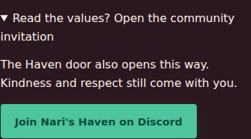
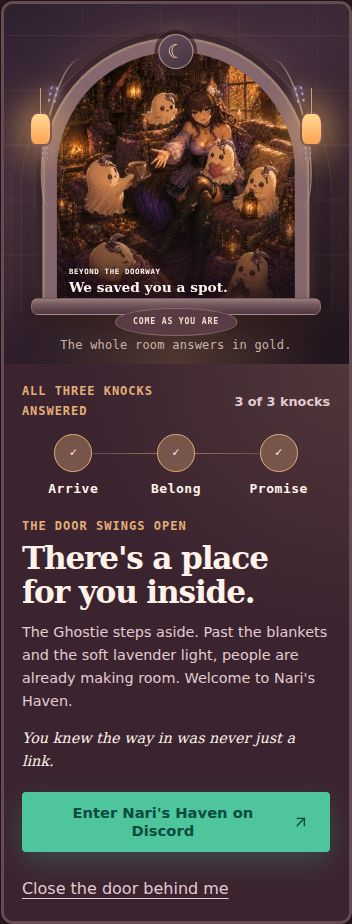

# v1 engineering candidate evidence — 19 October 2026

Repository: PocketKrow/NariNuna. Branch: `kiva/nari-v1-readiness`, PR #35 targeting main. Starting main: `23ab2b2c2ddd111d9d5c97b42a77b8422b13def2`. Engineering commits: `e7fecd1de094ffdb7602ed33e7f2326aa4db2a45` and local-QA transport correction `63a698ae81fe4cf09e6bd26e15339fe5c2062013`; the final documentation commit adds evidence without changing runtime source. The PR records the final exact SHA.

Environment: Node 24.19.0, npm 11.9.0, Linux. CI separately selects Node 22. No merge, deployment, version bump, release or approval clearance is included.

| Check | Observed result |
| --- | --- |
| Baseline `npm ci --no-audit --no-fund`, `npm run check` | Passed; 98 tests in 20 files, 12 documents, 165 essential asset checks, 27 supplied Prinnies |
| Final clean install and default `npm run check` | Passed; lint, zero Astro/Vue type errors/warnings/hints, full build/validators, 105 passed + 1 explicitly skipped test in 23 files, HTTP checks |
| Production fixture `NARI_DEPLOY_CONTEXT=production NARI_SITE_ORIGIN=https://example.com npm run check` | Passed; ten absolute public canonical/og:url entries, absolute social images, sitemap and robots validated; secret/404 excluded. Example origin is test-only, never an adopted domain |
| Full + `--omit=dev` audits | Before: 4 affected package entries, 3 high / 1 moderate. After: zero in both trees; raw reports alongside this file |
| Startup regression rerun | Explicit `127.0.0.1` and a selected nondefault port served real HTTP and rejected the other loopback address; missing output exited with Astro’s build-required message. Default 0.0.0.0:8080 test skipped only because this container’s `os.networkInterfaces()` raises `uv_interface_addresses` |
| `NARI_BROWSER_PATH=… npm run verify:browser` | Passed: all 12 routes at 320/390/768/1440, menu focus/Escape/resize, three knocks/focus/reset, secret return, failed thumbnails, reduced motion, no-JS and branded HTTP 404 |
| `NARI_BROWSER_PATH=… npm run verify:experience` | 31 Chromium cases passed, zero skips; includes eight unchanged snapshots, all-route axe, disabled-JS/blocked-door invitation, both keyboard knock controls and WebGL failure/recovery |
| `npm run verify:release` | Full build passed; readiness exited 1 for real unresolved owner/content/rights/host/manual-QA records plus preview mode. The direct script now runs the pipeline itself rather than trusting stale documents. The candidate production audit is now resolved from its report; owner/manual records remain open |
| `git diff --check` | Passed |

Chromium 153.0.8010.0 came from a separate temporary `@sparticuz/chromium` package after the managed browser download returned a truncated archive. The browser package, extraction and executable are outside the repository and are not application dependencies. Existing composition baselines were not regenerated.

Cross-browser completion: Chromium **31 passed, zero skipped**; Firefox 153.0 **17 passed, 14 skipped**; WebKit 26.5 **23 passed, 8 skipped**. The 16 non-Chromium snapshot skips are intentional (baselines belong to Chromium); Firefox’s six additional skips are graphics-dependent cases because that engine had no usable WebGL2. Static/unavailable-context cases, all-route axe, no-JS, both invitation failure modes, both knock controls, navigation and layout assertions ran. WebKit also exercised active graphics/failure recovery. No application assertions remain failed after the harness/environment corrections.

Executed the full `verify:release-browsers` script, then filtered Firefox/WebKit reruns after isolating environment/harness failures. Chromium’s successful 31-case portion was retained; the final WebKit rerun passed all eligible cases. The separate `verify:browsers` subset was not repeated because those Chromium/Firefox cases were already exercised. The temporary config changes only launch paths and the local server cwd; repository tests, timeouts, assertions and screenshot baselines are unchanged. WebKit initially exposed the pre-existing HTTP QA mismatch: the production CSP upgraded loopback assets to HTTPS on a listener with no TLS. The QA server now omits only `upgrade-insecure-requests` locally; a regression verifies that generated production headers retain it. No production security policy was weakened. The first combined attempt completed all 31 Chromium cases, then hit a Firefox page-creation sandbox restriction (`/proc/self/uid_map: EPERM`) before page code ran. It was stopped. Firefox’s local test process is rerun with `MOZ_DISABLE_CONTENT_SANDBOX=1`; WebKit uses its installed binary through a temporary launch wrapper with already available shared libraries. These container-only launch settings do not alter application code or CI browser defaults.

## Measured request behavior and visual review

`network-observations.json` records fresh 390/1440 contexts, 2.5 seconds after navigation to Home, Haven and Work, without scrolling or opening the door. No failed requests or duplicate image URLs occurred. Mobile requested no motion/graphics runtime. Desktop Home/Haven requested both; Work requested motion without graphics. Values are computed gzip sizes of files actually requested from an uncompressed local server, not production wire/compression measurements.

| Route | Initial JS/CSS before | After | Unchanged budget |
| --- | ---: | ---: | ---: |
| Home | 57.15 KB gzip | 57.93 KB gzip | 120 KB |
| Haven | 67.66 KB gzip | 68.70 KB gzip | 120 KB |
| Reachable optional graph | 174.85 KB gzip | 174.85 KB gzip | 180 KB |

Additional actual-layout checks covered all twelve routes at 430px without horizontal overflow. Existing suites cover 320/390/768/1440; short phone, 200% root-text and 1920/3840 layouts are exercised on the five representative routes. Root-font scaling is not native page zoom. No artwork bytes, framing rules or CSS composition baselines changed.

The inspected images below show the added native fallback (JavaScript disabled, disclosure expanded) and the preserved open doorway at 390px. The latter uses a taller viewport to capture the whole interaction without a sticky-header overlay. Both are review evidence using existing project artwork, not rights approval.

## Remaining launch evidence

The exact owner checklist is in `docs/17_CURRENT_STATE_AUDIT.md`: Nari’s wording/identity/art adoption, existing rights/attribution records, approved real nail photographs/captions, professional contact, immediate prelaunch Discord revalidation, host/account/origin and live HTTPS/header/cache/compression/rollback checks. Resources/stories remain honest nonblocking holds.

Physical devices, a named screen reader, native 400% page zoom, remaining manual contrast review and the actual production host are not attested by these automated results. `releaseReadiness.json` does not convert automated scans into those approvals. Roll back through normal revert or a previous-good validated artifact.
